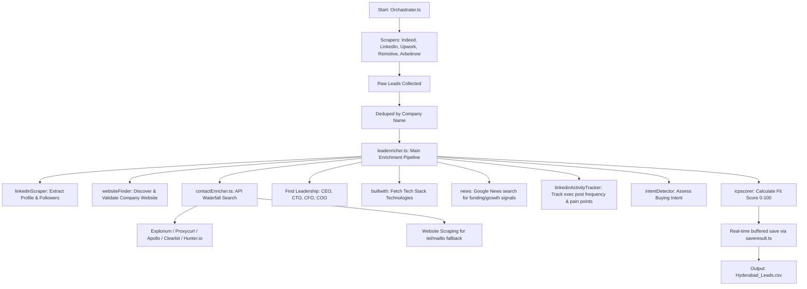

# ICP Lead Intelligence & Job Portal Scraper

A modular TypeScript-based intelligence pipeline designed to scrape job portal listings, discover target companies, enrich their contact details (emails, phone numbers, tech stack, leadership profiles) using a waterfall of public and paid APIs, score their Ideal Customer Profile (ICP) fit, and save findings in structured reports.

---

## 🏗️ Project Architecture & File Structure

The project follows a modular structure to separate scrapers, enrichment waterfalls, scoring algorithms, and utilities.

```
d:\Job Portal Scraper\
├── README.md                          # Comprehensive project guide (this file)
├── package.json                       # Project configuration, scripts, and dependencies
├── tsconfig.json                      # TypeScript compilation setup
├── .env                               # Local credentials and API keys (git-ignored)
├── .env.example                       # Template for API credentials and configs
├── extract_chromium.ps1               # Script to set up local Playwright headless Chromium
├── data/                              # Output directory for leads and intelligence reports
│   ├── Hyderabad_Leads.csv            # Default generated output file for lead details
│   └── competitor_intelligence.csv    # Generated competitor analysis report
└── src/
    ├── Orchastrater.ts                # Primary coordinator that runs the scraper and pipeline
    ├── PrecisionLeadSystem.ts         # Secondary targeted enricher for specific companies
    ├── database/                      # MongoDB Database persistence layer
    │   ├── connection.ts              # Singleton MongoClient manager
    │   ├── mongodb.ts                 # Barrel re-export
    │   ├── initDb.ts                  # Index bootstrapper (call once on startup)
    │   ├── models/                    # TypeScript interfaces / schemas
    │   └── repositories/              # Repository layer (CRUD + Upserts)
    ├── scrapers/                      # Crawler & API agents for job listings
    │   ├── Indeedscraper.ts           # Scrapes Indeed jobs using RSS feeds (avoids bot blocking)
    │   ├── glassdoorscraper.ts        # Scrapes LinkedIn jobs (public UI) & free APIs (Remotive, Arbeitnow)
    │   ├── upworkScraper.ts           # Scrapes Upwork freelance job postings via RSS feeds
    │   ├── linkedinScraper.ts         # Resolves and scrapes LinkedIn company profile pages
    │   └── redditIntelligence.ts      # Searches Reddit for company reviews/complaints (pain signals)
    ├── enrichers/                     # Data aggregation workflows
    │   ├── leadenricher.ts            # Main orchestrator for lead profiling (tech stack, news, leadership)
    │   ├── contactEnricher.ts         # Contacts waterfall (Explorium -> Proxycurl -> Apollo -> Clearbit -> Hunter -> Web)
    │   └── linkedinActivityTracker.ts # Tracks social posts/activity of leadership
    ├── scoring/                       # Evaluation algorithms
    │   ├── icpscorer.ts               # Assigns ICP score (0-100) and Tier (Hot, Warm, Cold) based on criteria
    │   └── intentDetector.ts          # Identifies purchase signals or growth intent
    └── utils/                         # Utilities and helper libraries
        ├── saveresult.ts              # Thread-safe buffered CSV saving utility
        ├── websiteFinder.ts           # Resolves company names to official website URLs (with HEAD checks)
        ├── emailExtractor.ts          # Raw website crawl email parser (for fallback search)
        └── validation.ts              # Shared validation functions (emails, domain checks)
```

---

## 🔄 Execution & Data Flow

When the pipeline starts, the data moves through the following stages:



1. **Scrape**: The orchestrator triggers portal scrapers based on search terms and target locations. RSS feeds are prioritized to avoid CAPTCHA blocks.
2. **Deduplicate**: Job posts are grouped by company, extracting aggregate statistics like hiring velocity.
3. **Enrich**:
   - **LinkedIn**: Resolves the company page and scrapes follower counts.
   - **Website**: Resolves the official homepage using Geekflare/DuckDuckGo and performs dynamic HEAD checks.
   - **Contacts Waterfall**: Queries APIs in order of decreasing confidence (Explorium $\rightarrow$ Proxycurl $\rightarrow$ Apollo $\rightarrow$ Clearbit $\rightarrow$ Hunter.io $\rightarrow$ Fallback Crawl).
   - **Tech Stack**: Queries BuiltWith API to extract up to 25 core technologies.
   - **Signals & News**: Crawls Google News for growth indicators and scans Reddit/LinkedIn for executive pain signals.
4. **Score**: `icpscorer.ts` grades the companies. High-value triggers (e.g., hiring a Head of Sales while in Series B) yield automatic **Hot** tiering.
5. **Save**: Leads are appended in real-time to prevent data loss.

---

## ⚙️ Configuration & Credentials

All settings are configured inside the `.env` file. A sample configuration template is available in `.env.example`.

### 🔑 Critical API Keys

| Key Name | Purpose | Resource |
|---|---|---|
| `EXPLORIUM_API_KEY` | Tier 1 B2B contacts, emails, and direct phones. | [Explorium Developer Portal](https://developers.explorium.ai/) |
| `PROXYCURL_KEY` | Tier 2 LinkedIn profile resolution and data mapping. | [Proxycurl Portal](https://nubela.co/proxycurl/) |
| `APOLLO_KEY` | Tier 3 Org/Contact Enrichment. | [Apollo.io API Keys](https://www.apollo.io/) |
| `CLEARBIT_API_KEY` | Tier 4 Headcount, sector, and basic meta. | [Clearbit Dashboard](https://dashboard.clearbit.com/api) |
| `HUNTER_KEY` | Tier 5 Domain email pattern verification. | [Hunter.io API Keys](https://hunter.io/api_keys) |
| `BUILTWITH_API_KEY` | Software stack / corporate tool identification. | [BuiltWith API Keys](https://builtwith.com/api) |
| `GEEKFLARE_API_KEY` | Public search query resolution (avoids IP blocks). | [Geekflare API Portal](https://rapidapi.com/geekflare/) |
| `LINKEDIN_SESSION_COOKIE` | `li_at` cookie to fetch profile data when browser is used. | Browser DevTools cookies under `li_at` |

---

## 🚀 How to Set Up & Run

### Prerequisites
- Node.js (v18+)
- Playwright browser binaries

### Setup Instructions
1. Install dependencies:
   ```bash
   npm install
   ```
2. Set up environment configuration:
   ```bash
   copy .env.example .env
   # Add your API credentials and keys to the .env file
   ```
3. Install browser binaries (runs Playwright Setup):
   ```powershell
   powershell -File extract_chromium.ps1
   ```
4. Run the lead intelligence pipeline:
   ```bash
   npm start
   ```
5. Run the type checker to verify code consistency:
   ```bash
   npm run typecheck
   ```

---

## 🗄️ Database Note
The project integrates a dual-persistence strategy. Leads are always saved locally to CSV files located under the `data/` folder. If a valid `MONGODB_URI` is provided in the `.env` configuration, leads are also automatically upserted into MongoDB, including index generation and scraping execution run statistics.
